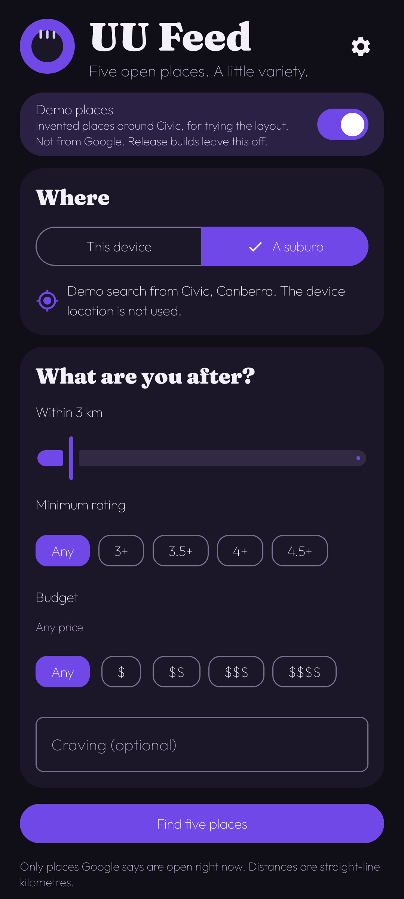
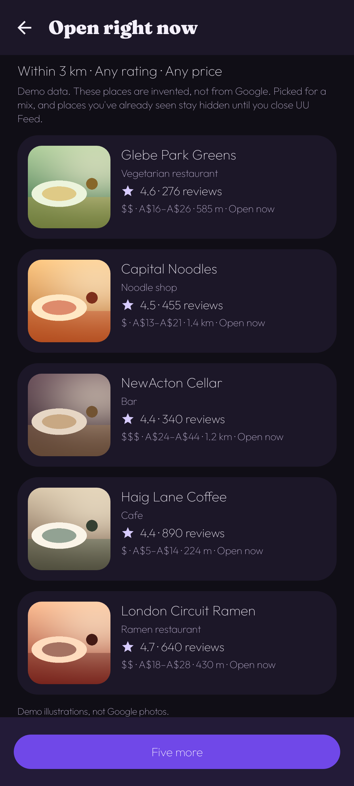
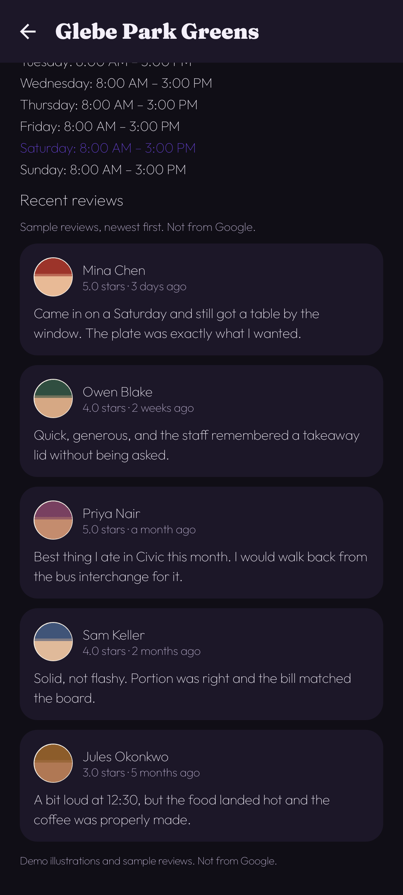
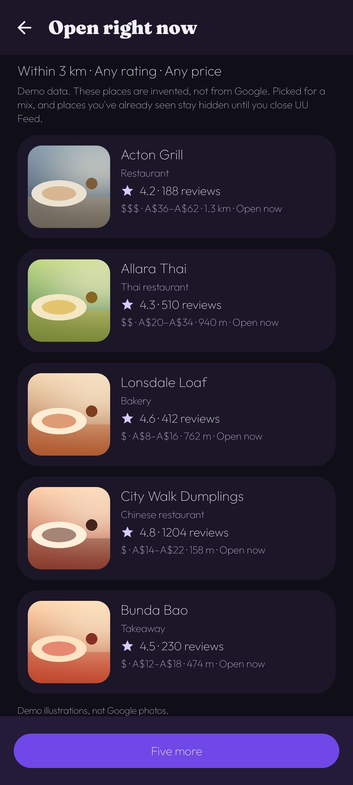
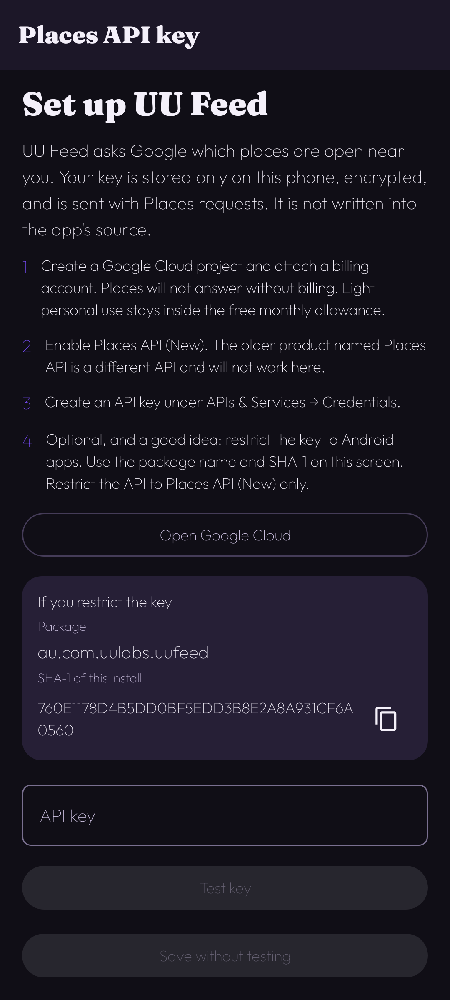

# UU Feed

UU Feed helps you pick somewhere to eat that is open right now. It asks Google Places for nearby places, then shows five of them with a mix of types instead of always handing back the five most famous. It works at any hour. Distances are kilometres. Prices are shown in the currency Google sends, which in Australia is usually AUD.

The app is dark, with violet controls. A key you paste in the app stays on the phone. Nothing in this repository is a real API key.











The screenshots are from a debug build with **Demo places** on. Those places, reviews, and illustrations are invented. They are not from Google.

## Install an APK

1. Open the [Releases](https://github.com/uulabs/UUFeed/releases) page.
2. Download `UU-Feed-debug.apk` from the latest release.
3. On the phone, open the file and allow install from that app if Android asks.
4. If a previous UU Feed was signed with a different key, uninstall it first, then install again.

The file is a debug-signed APK so it can be sideloaded. It is not a Play Store upload. Each release is signed by the GitHub-hosted build, so the SHA-1 can change between tags. The setup screen shows the SHA-1 of the copy you installed.

Every push also uploads the same APK as a build artifact, before a release exists.

## Add your Places API key

UU Feed cannot search until it has a key. The first launch opens setup when none is saved and none was baked in at build time.

1. Create a [Google Cloud](https://console.cloud.google.com/) project and attach a billing account. Places will not answer without billing. Light personal use stays inside the free monthly allowance.
2. Enable **Places API (New)**. The older product named Places API is a different API.
3. Create an API key under APIs & Services → Credentials.
4. Optional: restrict the key to Android apps. Package name `au.com.uulabs.uufeed`. SHA-1 is on the setup screen (there is a copy button). Also restrict the API to Places API (New) only.
5. In the app, tap **Open Google Cloud**. That opens the Places API (New) library page.
6. Paste the key and tap **Test key**. A successful test is one small call that asks only for place IDs.
7. Tap **Save and continue**. The key is stored with EncryptedSharedPreferences and is not committed anywhere.

Change or clear it later from the settings icon on the main screen. A key you save on the phone is used instead of any key that was compiled into the app.

### What it costs

Prices are Google's published first-band list prices in USD, after the free monthly cap, as of late 2026. Check the [Maps Platform pricing list](https://developers.google.com/maps/billing-and-pricing/pricing) before you rely on them. The field mask sets the price: one call is billed at the dearest field in the mask.

| Call | When | SKU | Free / month | Then, per 1,000 |
| --- | --- | --- | --- | --- |
| Key test | Test key | Text Search Essentials (IDs only) | Unlimited | $0 |
| Text Search | Each results fetch | Enterprise (rating, price, open-now hours) | 1,000 | $35 |
| Place Details | Opening a place, because reviews are requested | Enterprise + Atmosphere | 1,000 | $25 |
| Place Photo | Each photo the app loads | Place Details Photos | 1,000 | $7 |

A normal "find five" is one Text Search. **Five more** does not call Google again when the places already fetched still include unseen matches. If they don't, UU Feed may request up to three more pages, then a wider radius, and it stops after four Places calls per tap. Opening a place is one Details call. Five thumbnails are separate photo charges. Reviews are not requested on the search.

Place details and photo bytes are not written to disk.

## Build from source

- JDK 17 or newer
- Android SDK platform 37 and build-tools 36
- Android Studio that understands Android Gradle Plugin 9.5

```bash
cp local.properties.example local.properties
# sdk.dir is required. MAPS_API_KEY is optional.
./gradlew assembleDebug
./gradlew testDebugUnitTest
```

`local.properties` is gitignored. A key there is compiled into that build as a fallback. A key saved in the app replaces it. Do not commit a real key, a keystore, or a `build/` directory.

The debug APK from a local build is `app/build/outputs/apk/debug/app-debug.apk`.

```bash
adb install -r app/build/outputs/apk/debug/app-debug.apk
```

`./gradlew signingReport` prints the SHA-1 of your machine's debug key. It will not match a GitHub Release APK.

Debug builds include a **Demo places** switch with invented places, reviews, and illustrations. Release builds cannot turn that on.

## What a search does

- Uses the device location after you allow it. If you say no, type a suburb or address. When a name matches several places, an Australian match is preferred.
- Filters: radius from 0.5 km to 25 km, minimum rating (any / 3+ / 3.5+ / 4+ / 4.5+), budget mapped to Google price levels, and an optional craving.
- Only places Google says are open right now. Explicitly closed places are dropped.
- Five suggestions: name, rating, review count, price, distance, open status, and a photo.
- A place screen has photos, address, phone, website, hours, a Directions button that opens Google Maps, and up to five reviews sorted newest first on the phone.
- **Five more** skips places already shown in this app process. The list is memory only. Closing the app can clear it.

## Limitations

- Google returns **at most five reviews**, ordered by relevance. There is no newest-first parameter. UU Feed sorts those five by `publishTime`. A review with no timestamp sinks to the bottom. This is not a full feed of the newest reviews. Review photos are not in the API. Author profile photos are shown when Google sends them.
- Text Search location bias is not a hard circle, so the radius is enforced on the phone. A place with no hours flag is kept, because the query already asked for open places.
- A budget other than Any hides places with no price level.
- The device geocoder turns a typed suburb into coordinates. It is not a billed Geocoding call.
- The exclusion list lasts for the process only. It is not saved.
- Photo author names are shown when Google sends them. There is also a "Places and reviews from Google" line. If you ship this, follow the [Google Maps Platform attribution rules](https://developers.google.com/maps/documentation/places/web-service/policies).

Fraunces and Outfit are included under the SIL Open Font License. See `third_party/fonts/`.
